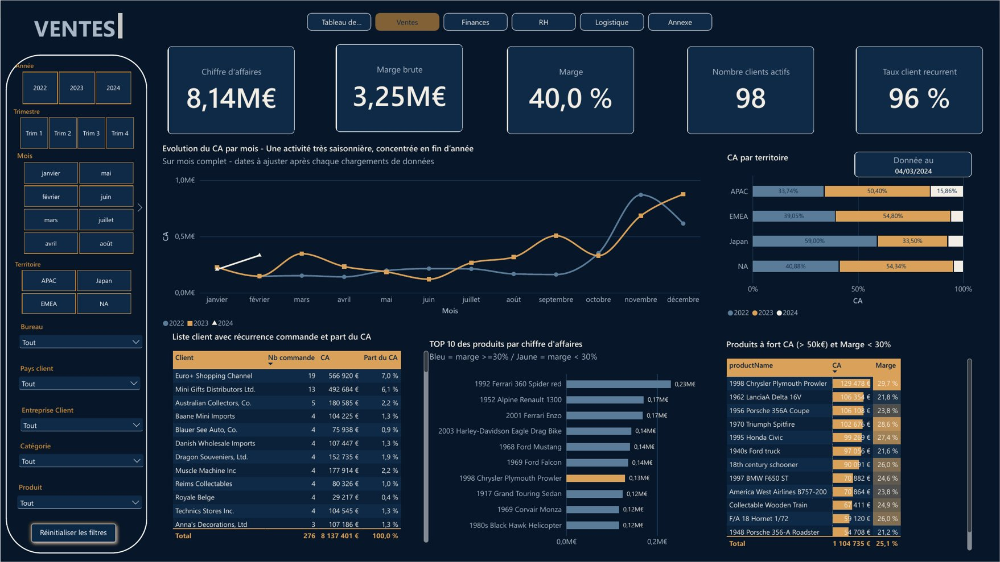
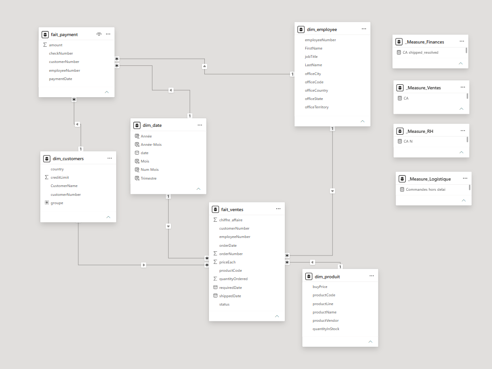
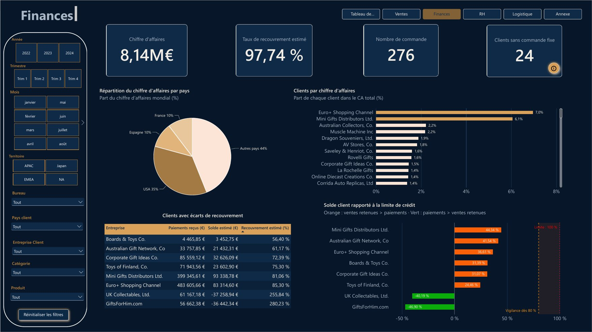
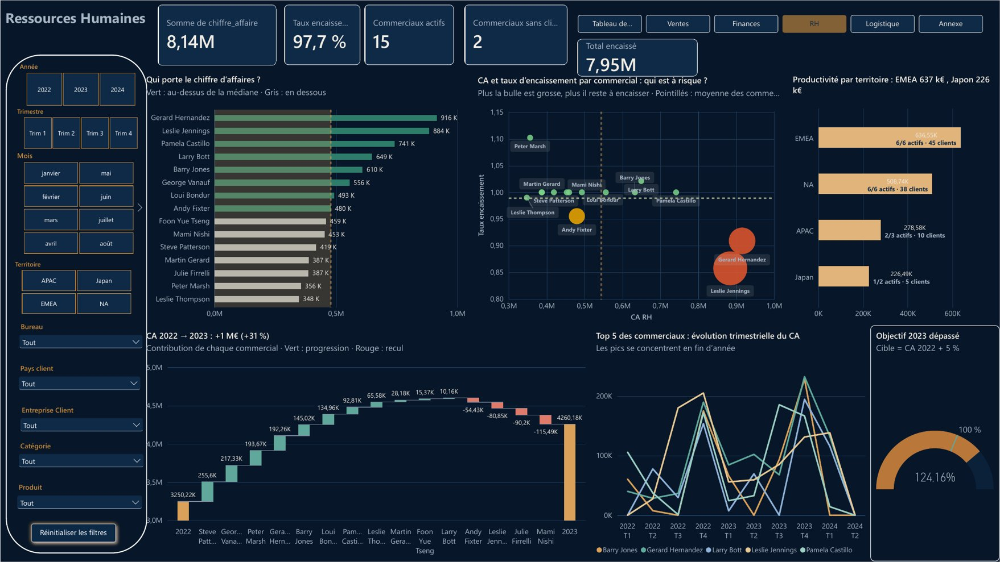
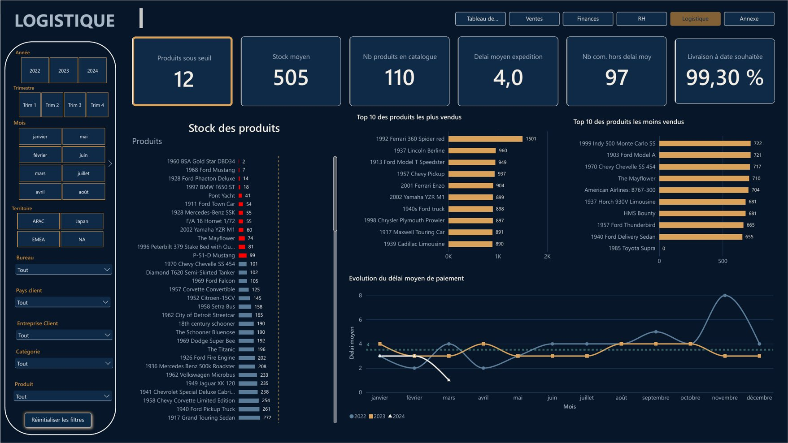
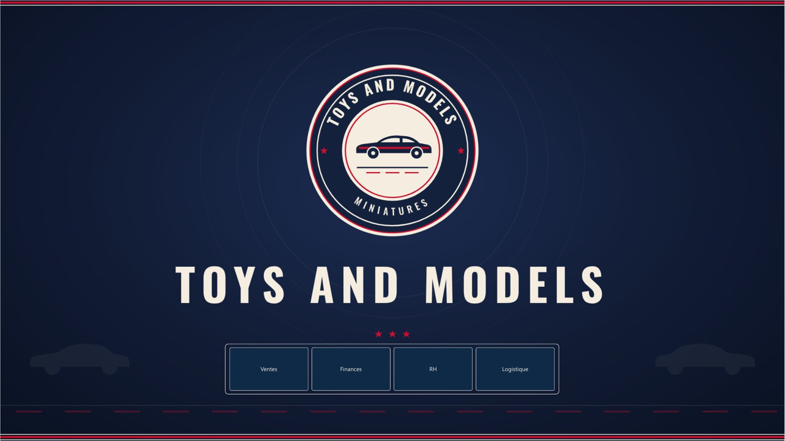

# Toys & Models – Business Performance Dashboard

🇬🇧 English version · 🇫🇷 [Version française](README.fr.md)

Group project completed at Wild Code School (October – November 2026), in a team of 4 using Agile methods (5 sprints, Scrum and Kanban).

**Tools:** SQL (MySQL) · star schema modeling · Power BI · Power Query · DAX



*The dashboard, table names and DAX measures are in French, as the project was delivered to a French-speaking client.*

## My contribution

- **Star schema**: full design (grain, fact and dimension tables, keys) and the SQL script that creates and loads the tables.
- **Sales**: sales KPIs and the Sales page of the dashboard.
- **DAX measures**: co-wrote the measures used across the dashboard.
- **Documentation**: wrote the project summary (KPI definitions, DAX measures, visualization choices, insights, limitations).

## The business need

Toys & Models sells scale models to retailers worldwide. Its sales data was stored in a transactional database but had never been analyzed.

The CEO, who has no technical background, wanted **a dynamic dashboard, refreshed every morning**, to run the business. We translated his request into **18 KPIs** across 4 areas: sales, finance, logistics and human resources.

## Approach

1. **Scoping**: reframing the request, prioritizing the KPIs, and clarifying ambiguities with the Product Owner.
2. **Data audit**: exploring an undocumented MySQL database, computing the first KPIs as SQL views, and writing a KPI dictionary.
3. **Modeling**: building a star schema directly in the SQL database.
4. **Dashboard**: loading the model into Power BI, writing DAX measures, one page per business area, with filters and interactions.
5. **Quality check and delivery**: cross-checking the figures, documenting, and presenting business-oriented results to the CEO.

## Data model

A star schema with **2 fact tables** and **4 dimensions**:

| Table | Grain / content |
| --- | --- |
| `fait_ventes` (sales) | 1 row = 1 product in an order |
| `fait_payment` (payments) | 1 row = 1 customer payment |
| `dim_customers` | customer, country, credit limit |
| `dim_produit` (products) | product, product line, stock, purchase price |
| `dim_employee` | sales rep, office, territory |
| `dim_date` | year, quarter, month (built in Power Query so it updates automatically) |



The script that creates and loads the tables is in [`modele_etoile.sql`](modele_etoile.sql).

## Sample DAX measures

```dax
CA = SUM(fait_ventes[chiffre_affaire])                          -- revenue

Prix achat = SUMX(fait_ventes, fait_ventes[quantityOrdered] * RELATED(dim_produit[buyPrice]))
Marge = [CA] - [Prix achat]                                     -- gross margin
Taux marge = DIVIDE([Marge], [CA])                              -- margin rate

Nb commande = DISTINCTCOUNT(fait_ventes[orderNumber])
Panier moyen = DIVIDE([CA], [Nb commande])                      -- average order value

Nb clients recurrents = COUNTROWS(FILTER(VALUES(fait_ventes[customerNumber]), [Nb commande] >= 2))
Nb client actif = DISTINCTCOUNT(fait_ventes[customerNumber])
Taux client recurrent = DIVIDE([Nb clients recurrents], [Nb client actif])   -- repeat customer rate
```

## Dashboard overview

One page per business area, with shared filters (year, quarter, month, territory, office, customer, product line, product).

| Finance | Human resources |
| --- | --- |
|  |  |

| Logistics | Home |
| --- | --- |
|  |  |

The full dashboard is available as a PDF: [`tableau_de_bord.pdf`](tableau_de_bord.pdf).

## Key insights

- **+30% revenue growth between 2022 and 2023**, driven by North America and EMEA (84% of revenue). Only Japan declined (−43%), after losing a customer that accounted for more than half of its revenue.
- **40% gross margin.** The best-selling product is also one of the most expensive and the most profitable: high prices do not hold back sales. Yet 18 high-revenue products have a margin below 30%, a lead for reviewing prices or discounts.
- **97.7% of revenue collected**, but a dependence on a few customers: a single customer accounts for 67% of revenue in Spain.
- **Concentrated sales performance**: 3 sales reps generate 31% of revenue, and 2 sales reps have no assigned customers.
- **Logistics**: 12 products below the critical stock threshold, and an average of 4 days between order and shipment.

## Limitations

- Payments are linked to customers, not to orders: customer balances and collection rates are therefore **estimates**, and payment delays could not be calculated.
- Stock levels are only updated every 2 months: the stock indicator is an alert, not real-time status.
- The database contains no sales targets: as an assumption, the target was set to the previous year's revenue + 5%.
- 15 of the 18 KPIs were delivered. The other 3 were not included, mainly because payments are not linked to orders and stock is not tracked continuously.

## Repository contents

| File | Content |
| --- | --- |
| `modele_etoile.sql` | SQL script that creates and loads the star schema |
| `Toys_and_Models_dashboard.pbix` | Power BI dashboard file |
| `tableau_de_bord.pdf` | Full dashboard as a PDF |
| `dashboard_*.jpg` | Screenshots of the dashboard pages |
| `modele_powerbi.png`, `schema_etoile.png` | Data model diagrams |
| `README.fr.md` | French version of this README |

## How to reproduce

1. Load the `toys_and_models` database into MySQL (provided by Wild Code School, not included in this repository).
2. Run `modele_etoile.sql` to create the fact and dimension tables.
3. Open `Toys_and_Models_dashboard.pbix` in Power BI Desktop and update the MySQL connection.
